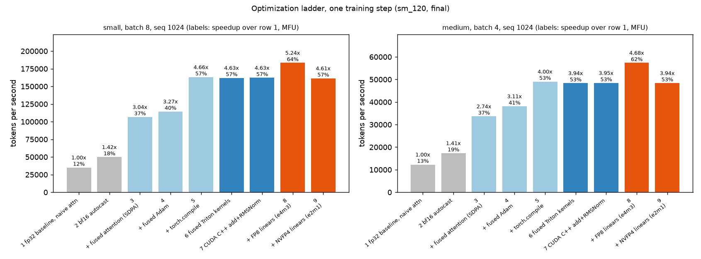
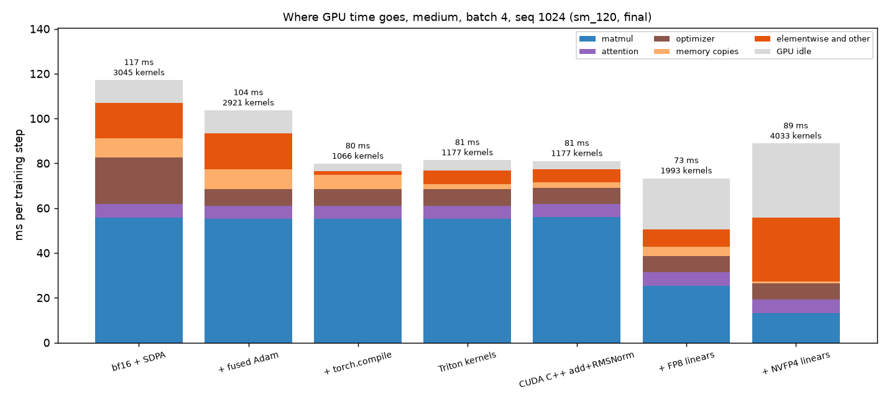
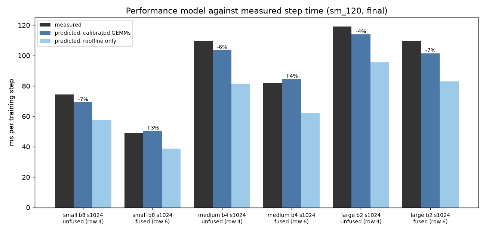
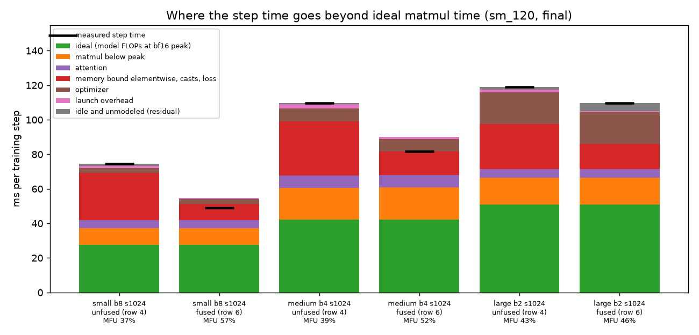
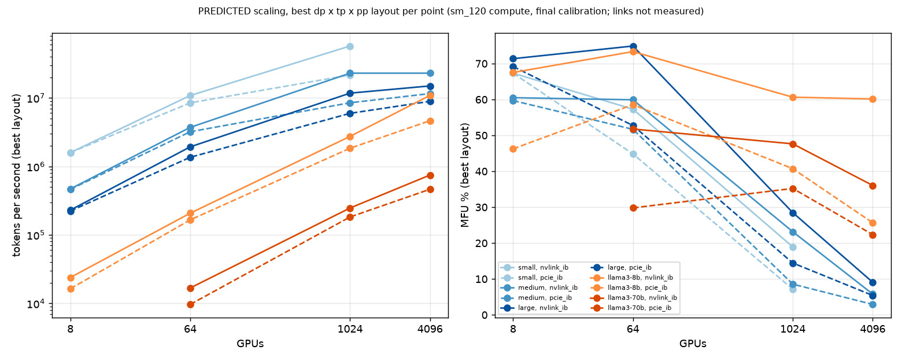
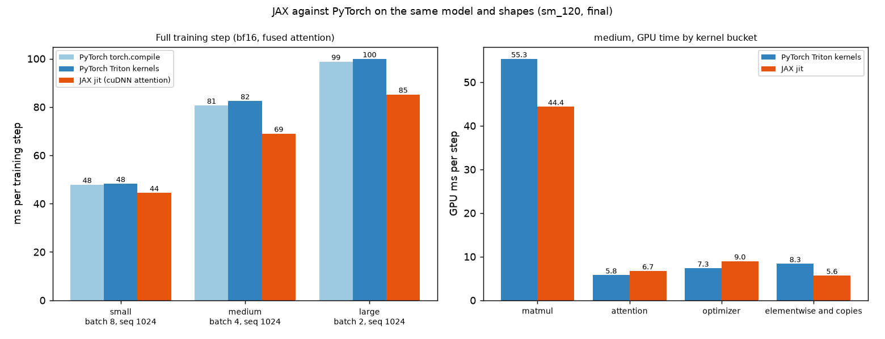

# llm-training-perf

Performance engineering for LLM training on an NVIDIA Blackwell GPU (`sm_120`). It takes a Llama style model from a plain PyTorch fp32 baseline at 12% MFU to 64% MFU (5.24x faster) by profiling the training step, writing fused Triton and CUDA C++ kernels with forward and backward passes, and training the block GEMMs in FP8, with NVFP4 (4 bit) measured alongside. A roofline performance model predicts the step time within 4.6% mean error (2.7% on held out shapes), and the same model drives a data, tensor and pipeline parallel scaling model up to 4096 GPUs, a Chakra workload export run in ASTRA-sim, and a comparison with a JAX port.

Every number below was measured on one `sm_120` GPU (32 GB) under WSL2 Ubuntu 24.04 with PyTorch 2.11.0+cu128, CUDA 12.8 and Triton 3.6, machine label `final`. Raw results are in [`results/`](results), and [`results/LOG.md`](results/LOG.md) records every run in order, including the mistakes found and fixed along the way.

## Contents

1. [Optimization ladder](#1-optimization-ladder)
2. [Where the time goes](#2-where-the-time-goes)
3. [Kernels](#3-kernels)
4. [FP8 and NVFP4](#4-fp8-and-nvfp4)
5. [Performance model](#5-performance-model)
6. [Scaling predictions](#6-scaling-predictions)
7. [Simulator workload export](#7-simulator-workload-export)
8. [JAX comparison](#8-jax-comparison)
9. [How to run](#9-how-to-run)
10. [Hardware](#10-hardware)
11. [Limitations](#11-limitations)

## 1. Optimization ladder

A real training step (forward, backward, AdamW update) on one fixed batch of random tokens. The model is a Llama style decoder: pre norm RMSNorm, packed qkv, RoPE, causal attention, SwiGLU MLP, untied embedding and head, vocab 32000. Step time is the median of 20 synchronized steps after 5 warmup steps. MFU is model FLOPs (6 x matmul parameters + 12 x layers x d x seq per token) divided by the bf16 matmul peak measured in the same run.



| Row | `small` 134M, batch 8, seq 1024 | | | `medium` 375M, batch 4, seq 1024 | | |
|---|---|---|---|---|---|---|
| | ms/step | speedup | MFU | ms/step | speedup | MFU |
| 1 fp32 baseline, naive attention | 233.85 | 1.00x | 12.3% | 333.97 | 1.00x | 13.4% |
| 2 bf16 autocast | 164.34 | 1.42x | 17.5% | 236.37 | 1.41x | 18.9% |
| 3 + fused attention (SDPA) | 76.85 | 3.04x | 37.5% | 121.81 | 2.74x | 36.6% |
| 4 + fused Adam | 71.61 | 3.27x | 40.2% | 107.50 | 3.11x | 41.5% |
| 5 + `torch.compile` | 50.23 | 4.66x | 57.3% | 83.51 | 4.00x | 53.4% |
| 6 fused Triton kernels (no compiler) | 50.55 | 4.63x | 57.0% | 84.70 | 3.94x | 52.7% |
| 7 CUDA C++ add + RMSNorm | 50.52 | 4.63x | 57.0% | 84.58 | 3.95x | 52.7% |
| 8 + FP8 linears (e4m3) | **44.67** | **5.24x** | **64.5%** | **71.40** | **4.68x** | **62.5%** |
| 9 + NVFP4 linears (e2m1) | 50.76 | 4.61x | 56.7% | 84.66 | 3.94x | 52.7% |

Source: `results/milestones/m5_sweep_final_sm_120_*_b*_s1024.json`, all rows from one run. Peak memory falls from 15.9 GB to 4.7 GB on `small` with FP8 (4.4 GB with NVFP4). All losses stay finite.

- Fused attention is the biggest single step. Naive attention keeps several copies of a 1024 by 1024 score matrix per head, and SDPA's flash kernel never writes it, halving the step time and saving 7 to 9 GB.
- bf16 alone gives only 1.4x even though bf16 matmuls run 3.5x faster than fp32. Most of the step was not matmul yet.
- Four hand written Triton kernels (row 6) match what `torch.compile` gets by fusing the whole graph (row 5), with slightly less memory and no compiler.
- One note per optimization with its measured gain is in [`optimizations/`](optimizations).

## 2. Where the time goes

`profile_step.py` runs the step under the PyTorch profiler, buckets every GPU kernel, and measures GPU idle time against a step timed without the profiler.



| `medium`, batch 4, seq 1024 | bf16 + SDPA | + fused Adam | + `torch.compile` | Triton kernels |
|---|---|---|---|---|
| matmul | 52.1% | 59.0% | 71.9% | 72.1% |
| attention | 5.7% | 6.4% | 7.9% | 7.5% |
| optimizer | 19.4% | 7.8% | 9.6% | 9.5% |
| memory copies (casts) | 7.9% | 9.5% | 8.3% | 3.1% |
| elementwise and other | 14.8% | 17.2% | 2.4% | 7.8% |
| kernel launches per step | 3045 | 2921 | 1066 | 1177 |
| GPU idle | 8.6% | 9.9% | 4.1% | 5.7% |
| step time | 117.1 ms | 103.7 ms | 79.9 ms | 81.4 ms |

After bf16 and fused attention, half the GPU time was still non matmul work spread over about 2400 small kernels. That finding is why the fused kernels exist. With them, launches drop by 60%, elementwise plus copy time drops from 25 ms to 8.4 ms, and matmuls become 72% of the step.

An Nsight Systems trace with NVTX ranges per step, phase and block confirms the fused step is GPU bound: the CPU queues a step in about 31.5 ms while the GPU needs 81 ms.

## 3. Kernels

`kernels/triton_ops.py` has four fused operations, each with a forward and a backward kernel, all math in fp32 and loads and stores in the tensor dtype:

- **Residual add plus RMSNorm.** It reads a bf16 sublayer output and an fp32 residual directly. The weight gradient is reduced in registers across a persistent grid.
- **SwiGLU.** The sigmoid is recomputed in the backward.
- **RoPE on the packed qkv output.** It writes q, k and v straight into the layout attention reads, and the backward writes straight back into the packed layout.
- **Chunked lm head plus cross entropy.** The full logits are never built: each 2048 row chunk is turned into its own gradient in place.

`kernels/cuda_ext/add_rmsnorm.cu` is the same add plus RMSNorm in CUDA C++, built with `torch.utils.cpp_extension`. It uses vectorized loads, warp shuffle reductions, shared memory for the cross warp step and a persistent backward grid.

**Correctness: 142 of 142 checks pass** (`kernels/test_kernels.py`). Every output and every gradient is compared against a float32 reference in fp32, bf16 and the mixed bf16 plus fp32 case used in training. Errors are about 1e-7 in fp32 and about 2e-3 in bf16, which is bf16's own rounding. The tests caught a real bug: 1024 threads per block made the CUDA backward fail to launch at width 8192. Training the PyTorch, Triton and CUDA models from the same weights gives loss curves within 1.4% of each other.

**Microbenchmarks**, forward plus backward, `small` training shapes (8192 tokens), L2 cleared before every call (`kernels/bench_kernels.py`):

| Op | eager | `torch.compile` | Triton | CUDA C++ | best vs eager | best vs compile |
|---|---|---|---|---|---|---|
| RMSNorm | 0.328 ms | 0.179 ms | 0.072 ms, 97% of bandwidth | | 4.52x | 2.48x |
| add + RMSNorm | 0.383 ms | 0.175 ms | 0.123 ms, 100% | 0.122 ms, 100% | 3.13x | 1.43x |
| SwiGLU | 0.241 ms | 0.176 ms | 0.176 ms | | 1.37x | 1.00x |
| RoPE on qkv | 0.570 ms | 0.248 ms | 0.109 ms, 97% | | 5.25x | 2.28x |
| lm head + cross entropy | 12.85 ms, 3.08 GB | 7.20 ms, 0.52 GB | 6.89 ms, 0.31 GB | | 1.87x | 1.05x |

The norm and RoPE kernels run at the memory bandwidth limit. The CUDA C++ and Triton versions of add plus RMSNorm tie to four digits, so hand written CUDA has nothing left to win on a memory bound op. The chunked cross entropy uses 10x less memory than eager.

**Each kernel alone in the real step** (`medium`, ablation in `kernels/ablate_kernels.py`): RoPE saves 7.7%, add plus RMSNorm 5.1%, RMSNorm 4.7%, cross entropy 2.4% (and the most memory, 1.17 GB), SwiGLU 0.9%. All five together save 21.6%, close to the 20.9% sum, so the gains are independent.

## 4. FP8 and NVFP4

Measured dense matmul peak on 8192 cubed matrices (`results/calibration_final.json`):

| Precision | TFLOPs | vs bf16 |
|---|---|---|
| fp32 | 65.3 | 0.29x |
| tf32 | 110.1 | 0.48x |
| fp16 | 220.3 | 0.97x |
| bf16 | 227.5 | 1.00x |
| FP8 (e4m3) | 447.1 | 1.97x |
| **NVFP4 (e2m1, one e4m3 scale per 16 values)** | **1291.7** | **5.68x** |

Memory bandwidth 1441 GB/s from a 1 GB device copy. MXFP4 (e8m0 scales per 32 values) is rejected by PyTorch 2.11's `_scaled_mm` on this GPU, so FP4 here means NVFP4.

`kernels/lowp.py` runs all three GEMMs of every block linear (forward, input gradient, weight gradient) in low precision, with fp32 master weights:

- **FP8:** per tensor scales computed every step.
- **NVFP4:** values in e2m1, packed two per byte, with block scales along each GEMM's own contraction axis and stochastic rounding for gradients. Quantization is a Triton kernel that reads through strides (no transpose copy) and writes the block scales directly in the tiled layout the Blackwell GEMM reads. It is bit exact with a PyTorch reference.

The FP4 GEMM matches a float32 matmul of the dequantized operands to 3e-7 (`kernels/test_lowp.py`, 22 of 22 checks pass).

| `medium` | bf16 (row 6) | FP8 | NVFP4 |
|---|---|---|---|
| step time | 84.70 ms | **71.40 ms (1.19x)** | 84.66 ms (1.00x) |
| block GEMMs, GPU time | about 51 ms | about 21 ms (2.4x) | **about 9 ms (5.6x)** |
| quantization, GPU time | | about 5 ms | 18.3 ms |
| kernels per step | 1177 | 1993 | 4033 |
| GPU idle | 5.7% | 31% | 37% |
| steps to loss < 1.0 (`small`, 200 steps) | 32 | 33 | 36 |
| final loss | 0.0005 | 0.0005 | 0.0006 |

The NVFP4 tensor cores deliver inside the real step: the block GEMMs run 5.6x faster than bf16, the same ratio as the calibration. The whole step is not faster yet, for two reasons. Quantizing six tensors per linear costs twice the FP4 GEMM time, and at 4033 launches per step the GPU sits idle 37% of the time. Fusing quantization into the producing kernels and capturing the step in a CUDA graph are the next steps. FP8 is the practical win at this size. Both formats train stably; NVFP4 learns about 12% slower early on, the known cost of 4 bit gradients.

## 5. Performance model

`perf_model/roofline.py` lists every GPU operation in the step with its FLOPs, bytes moved and kernel launches, for the unfused and the fused model, and predicts the time:

```
time per op = max(FLOPs / peak, DRAM bytes / bandwidth + L2 bytes / L2 bandwidth)
step time   = max(sum of op times + launches x 0.94 us,  launches x 6.5 us of CPU issue time)
```

GEMM and attention calls use times measured at their exact shapes on this GPU. The first version was 28% off because it charged the CPU's 6.5 us launch cost to every kernel and sent all eager traffic to DRAM. On the GPU a kernel costs 0.94 us, the CPU runs ahead of it, and eager intermediates stay in the 96 MB L2 cache.



| Config | Measured | Predicted | Error |
|---|---|---|---|
| `small` b8, unfused | 74.43 ms | 69.21 ms | -7.0% |
| `small` b8, fused | 49.04 ms | 50.43 ms | +2.8% |
| `medium` b4, unfused | 109.75 ms | 103.64 ms | -5.6% |
| `medium` b4, fused | 81.64 ms | 84.58 ms | +3.6% |
| `large` b2, unfused | 118.98 ms | 113.90 ms | -4.3% |
| `large` b2, fused | 109.71 ms | 101.50 ms | -7.5% |

**Mean absolute error: 5.6% unfused, 4.6% fused. On five held out configurations: 6.1% and 2.7%.** The same config measured in two sessions differed by 6.6% from GPU clock state alone, so the model's error is about the size of the noise. A pure roofline with peak numbers only is about 22% too fast at every size; that gap is GEMM inefficiency.

**MFU gap**, `medium` fused, 81.6 ms at 52% MFU:



| Category | ms |
|---|---|
| ideal: model FLOPs at the bf16 peak | 42.3 |
| matmuls below peak (they reach 67 to 75%; cuBLAS picks Ampere generation `cutlass_80` kernels here) | 18.5 |
| memory bound elementwise, casts, loss | 13.8 |
| optimizer (grows with parameters: 18.3 ms on `large`) | 7.3 |
| attention | 7.2 |
| launch gaps | 1.0 |
| residual (measured minus modeled; the model overshoots some categories) | -8.4 |
| measured step | 81.6 |

The categories are modeled estimates from the calibrated performance model, so they sum to 90.1 ms; the negative residual brings the total back to the measured 81.6 ms (`results/milestones/m6_validate.txt`).

**What if**, `medium` fused: doubling memory bandwidth gives -12.4%, doubling the matmul peak -37.0%, removing launch cost -1.2%. For the unfused model, doubling bandwidth gives -18.7%. Fusion moved the step from bandwidth bound to compute bound.

## 6. Scaling predictions

**This section is a prediction.** Only one GPU was available, so no NCCL all reduce could be timed. The link constants in [`perf_model/links.json`](perf_model/links.json) are effective bandwidths for NVLink 4 class links (360 GB/s per GPU), PCIe Gen5 without peer access (25 GB/s) and 400 Gb/s InfiniBand (45 GB/s), each with its source, meant to be replaced by measured `nccl-tests` numbers. The GPU measured here has no NVLink, so the NVLink rows describe a hypothetical cluster of GPUs with this compute and 32 GB memory; the PCIe rows are the case that applies to this card.

`perf_model/scaling.py` takes compute per GPU from the validated performance model on the sharded shapes (all 1422 sharded GEMM and attention shapes timed on this GPU). On top of that it models:

- tensor parallel all reduces (2 forward and 2 backward per layer)
- the 1F1B pipeline bubble, (p - 1) / (m + p - 1), and the sends between stages
- the hierarchical data parallel gradient all reduce, overlapped with the last backward pass
- a ZeRO 1 optimizer
- a memory check against 32 GB

For each point it searches about 400 layouts and keeps the fastest that fits. Ring all reduce time is 2 (n - 1) / n x bytes / bandwidth + 2 (n - 1) x latency.



Best layout MFU, NVLink inside 8 GPU nodes, InfiniBand between nodes:

| Model | 8 GPUs | 64 | 1024 | 4096 |
|---|---|---|---|---|
| `medium` | 60.5% | 59.9% | 23.2% | 5.8% |
| `large` | 71.4% | 74.9% | 28.5% | 9.1% |
| Llama 3 8B shape, seq 4096 | 67.5% | 73.3% | 60.6% | 60.1% |
| Llama 3 70B shape, seq 4096 | does not fit | 51.8% | 47.6% | 36.1% |

- With a fixed 0.5M token batch, small models run out of work: 1024 GPUs leave 512 tokens each, and MFU collapses. Llama 3 at 4.2M tokens keeps 60% at 4096 GPUs (10.9M tokens per second).
- Llama 3 70B needs tensor, pipeline and data parallelism plus activation checkpointing to fit 32 GB GPUs. At 4096 GPUs the pipeline bubble is the largest loss, 28% of the step.
- With PCIe inside the node instead of NVLink, Llama 3 8B at 4096 GPUs drops from 60% to 26% MFU, because tensor parallel communication becomes the bottleneck.

## 7. Simulator workload export

NVIDIA's own processor and system simulators are proprietary. [`workload_export/`](workload_export) produces an open format workload of the same kind: one training step as an operator graph, one graph per rank, for any data, tensor and pipeline parallel layout.

- **Node contents:** type (GEMM, elementwise, reduction, memory copy, collective, send, receive), tensor shapes and dtypes, FLOPs, bytes, dependencies and a predicted duration.
- **Collectives:** tensor parallel all reduces, 1F1B pipeline sends and receives, and per layer gradient all reduces.
- **Formats:** plain JSON, and the MLCommons Chakra execution trace format that ASTRA-sim reads.

| Check | Result |
|---|---|
| Summed FLOPs and bytes against the performance model, per category | exact match (0.0 difference) for all four exported layouts, up to Llama 3 8B on 32 ranks |
| Decoded with MLCommons' own Chakra protobuf classes | 49 of 49 files |
| Every send has a matching receive; every group issues the same collectives | 128 pairs and 8736 collective calls for the Llama layout |
| Against a real PyTorch execution trace (`ExecutionTraceObserver`) | same 366 GEMM shapes, same forward order, same 24 + 24 attention calls |

**ASTRA-sim** (built from source, commit `4ce9ecf`, analytical backend, same link constants):

| Layout | Scaling model | ASTRA-sim, our per op times | ASTRA-sim, its roofline |
|---|---|---|---|
| `medium`, dp2 tp2 pp2, 4 microbatches | 81.5 ms | 87.3 ms (+7%) | 53.8 ms (-34%) |
| Llama 3 8B shape, dp2 tp8 pp2, 4 microbatches | 558.5 ms | 648.1 ms (+16%) | 568.4 ms (+2%) |

Two independent tools agree within 16% on the same workload. ASTRA-sim's own roofline assumes every GEMM runs at peak, which is why it comes out 34% too fast for `medium`, whose GEMMs were measured at 67 to 75% of peak.

## 8. JAX comparison

[`jax_port/`](jax_port) ports the whole training step to JAX with `jax.jit`: same model, shapes, mixed precision and AdamW. One block with copied weights matches PyTorch's output and every gradient within bf16 rounding (worst 4.5e-3).



| Size | `torch.compile` | Triton kernels | JAX jit (cuDNN attention) |
|---|---|---|---|
| `small` b8 | 47.88 ms, 58.0% | 48.25 ms, 57.3% | **44.48 ms, 61.4%** |
| `medium` b4 | 80.67 ms, 53.1% | 82.49 ms, 51.9% | **69.01 ms, 60.8%** |
| `large` b2 | 98.80 ms, 51.3% | 99.88 ms, 50.8% | **85.19 ms, 58.9%** |

The PyTorch and JAX columns come from separate runs (JAX: `results/milestones/m9_jax_*.txt`, PyTorch: `m9_compare_medium.txt` and `m9_pytorch_small_large.txt`). In the single `compare.py` run that timed both on `medium`, JAX took 70.61 ms (59.3% MFU), 1.14x faster than `torch.compile` instead of 1.17x.

JAX is 1.08x to 1.17x faster than the best PyTorch configuration in the table (1.14x on `medium` when both are timed in the same run). On `medium`, about 11 ms of the 12 to 13.5 ms gap to the Triton kernels is matmul time. The differences in fusion:

- **GEMMs:** XLA generates and autotunes its own Triton GEMM kernels (313 per step, 2 cuBLAS calls), while PyTorch sends every matmul to cuBLAS. For the weight gradient GEMMs, where the token dimension is contracted, XLA's kernels are 1.43x faster (171 against 120 TFLOPs).
- **Sibling GEMMs:** XLA merges the gate and up projections, which share an input, into one GEMM. Neither `torch.compile` nor the hand written path does.
- **Elementwise:** about even. XLA takes 5.6 ms, against 8.3 ms for the hand written kernels and about 8 ms for `torch.compile`.
- **Optimizer:** the hand written fused Adam beats XLA's AdamW, 7.3 ms against 9.0 ms. XLA does not fuse the optimizer into one kernel on its own.
- **Attention:** fused attention comes from cuDNN in JAX. XLA's own lowering of the same op materializes the scores and is 1.4x slower with twice the memory.

## 9. How to run

Linux or WSL2 Ubuntu with an NVIDIA GPU. FP8 needs compute capability 8.9 or newer, NVFP4 needs Blackwell.

```bash
python3 -m venv ~/venvs/llmperf && source ~/venvs/llmperf/bin/activate
pip install torch==2.11.0 --index-url https://download.pytorch.org/whl/cu128
pip install -r requirements.txt
python -c "import torch, triton; print(torch.__version__, torch.cuda.is_available(), triton.__version__)"
```

The CUDA C++ kernel also needs the CUDA 12.8 toolkit (`nvcc`) and `ninja`. The JAX port uses its own venv; see `requirements.txt`.

```bash
# calibration and the ladder
python bench_train.py --calibrate-only --machine-label final
python bench_train.py --sweep --size small --batch 8 --seq 1024 --machine-label final
python bench_train.py --sweep --size medium --batch 4 --seq 1024 --machine-label final

# profiler (also --kernels triton|cuda, --linear fp8|fp4)
python profile_step.py --size medium --batch 4 --seq 1024 --fused-adam --machine-label final
nsys profile -t cuda,nvtx -o profiles/nsys_medium python bench_train.py --size medium --batch 4 --seq 1024 --nvtx --warmup 3 --steps 5

# kernels
python kernels/test_kernels.py
python kernels/test_lowp.py
python kernels/bench_kernels.py --size small --batch 8 --seq 1024 --machine-label final
python kernels/ablate_kernels.py --size medium --batch 4 --seq 1024 --machine-label final
python kernels/check_loss_parity.py --size small --steps 200 --modes triton,triton+fp8,triton+fp4 --tol 0.10

# performance model and scaling
python perf_model/validate.py --machine-label final
python perf_model/roofline.py --size medium --batch 4 --seq 1024 --what-if bw=2 --what-if peak=2
python perf_model/scaling.py --machine-label final --measure-shapes

# simulator export (ASTRA-sim build steps in workload_export/README.md)
python workload_export/export_trace.py --size medium --batch 2 --seq 1024 --dp 2 --tp 2 --pp 2 --microbatches 4
python workload_export/check_export.py profiles/workload/medium_b2_s1024_dp2_tp2_pp2_m4
python workload_export/observe_pytorch.py --size medium --batch 4 --seq 1024
python workload_export/run_astra_sim.py profiles/workload/medium_b2_s1024_dp2_tp2_pp2_m4

# JAX comparison (runs the JAX venv as a subprocess)
python jax_port/compare.py --size medium --batch 4 --seq 1024 --machine-label final

# charts for this README
python make_charts.py --machine-label final
```

Every script writes a JSON summary to `results/` and its large traces to `profiles/` (not committed). All benchmark scripts cap PyTorch at 97% of GPU memory, so a configuration that does not fit is recorded as `oom` instead of silently spilling into system RAM, which on WSL2 made one run 10x slower.

## 10. Hardware

One NVIDIA Blackwell GPU, architecture `sm_120`, compute capability 12.0, 32 GB, 170 SMs, 96 MB L2, in a Windows 11 machine running WSL2 Ubuntu 24.04. Every result file records the architecture tag and machine label, never the product name.

## 11. Limitations

- **One GPU.** All multi GPU results (scaling model, ASTRA-sim runs) are predictions with unmeasured link constants.
- **One architecture.** The plan included a comparison with an Ampere (`sm_86`) GPU. No Ampere results were collected, so the architecture findings cover Blackwell only.
- **Synthetic data.** Training uses one fixed batch of random tokens. Step speed does not depend on the data, but the loss curves are a memorization test, not evidence about convergence on real data.
- **NVFP4 is not faster yet.** Its GEMMs are 5.6x faster, but quantization and launch overhead cancel the gain at these model sizes. The recipe also leaves out random Hadamard transforms and 2D weight blocks.
- **FP8 without Transformer Engine.** The FP8 and NVFP4 paths are written directly on `torch._scaled_mm`.
- **Run to run variation.** Step times varied by up to about 6% between sessions from the GPU's clock state. Rows within the ladder table and within the kernel ablation were measured in the same run. Other tables combine runs from different sessions: the profiler columns, the FP8/NVFP4 GPU times (from separate profiler runs) and the PyTorch against JAX comparison (see section 8).
- **The performance model is calibrated on this GPU.** Predictions for other GPUs need their own calibration file and GEMM shape timings.
- **ASTRA-sim shutdown crash.** This ASTRA-sim build sometimes crashes while printing statistics after the simulation has finished. Results are kept only when every pipeline stage reported and its ranks agree to the tick.

## Repository layout

```
bench_train.py            model, training step, optimization ladder, calibration
profile_step.py           profiler with kernel buckets, GPU idle and Chrome traces
make_charts.py            README charts from saved results
kernels/                  Triton kernels, CUDA C++ extension, FP8 and NVFP4 layers, tests, benchmarks
optimizations/            one note per optimization with its measured gain
perf_model/               roofline performance model, validation, scaling model, link constants
workload_export/          operator graph export, Chakra writer, checks, ASTRA-sim runner
jax_port/                 JAX port and the comparison with PyTorch
results/                  JSON summaries, charts, LOG.md (committed)
profiles/                 Chrome, Nsight, JAX traces and large exports (not committed)
```
